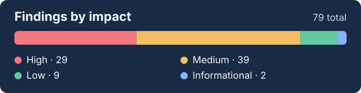

# GTM Teardowns

I review what buyers can verify before a sales call. Each teardown traces a public claim to its source, explains why it matters and recommends a change.

Prepared by [Arunim Shukla](https://www.linkedin.com/in/arunimshukla).

> **One finding.** SquadStack's `llms.txt` gave Choice India a **200% reduction in customer acquisition cost**. The linked case study said **70%**. The file presented itself as the canonical source. [Read the finding](./SquadStack.ai.md#1-the-canonical-facts-file-disagrees-with-the-case-studies).

## Published reviews

<!-- review-index:start -->
| Sr. no. | Review | Key takeaway | Findings | Last checked |
|:---:|:--|:--|--:|:--|
| 1 | [SquadStack.ai](./SquadStack.ai.md) | A customer result changes between the case study and the facts file. | 15 | 7 November 2026 |
| 2 | [Arcanna.ai](./Arcanna.ai.md) | The homepage omits the scope that makes named SOC outcomes useful. | 10 | 7 November 2026 |
| 3 | [Zaperon](./Zaperon.md) | The reporting guide leaves buyers to verify integrity and retention controls. | 2 | 7 November 2026 |
| 4 | [Palm Olympia](./Palm-Olympia.md) | Similar-looking enquiry routes and image-only offers obscure the buying terms. | 8 | 7 November 2026 |
| 5 | [Massive · machine-readable review](./Massive%20GEO.md) | Two public facts files disagree about the same company and its products. | 14 | 11 August 2026 |
| 6 | [ChainSecurity](./ChainSecurity.md) | The audit PDFs contain proof buyers cannot scan on the website. | 16 | 3 August 2026 |
| 7 | [Bolt.new](./Bolt.new.md) | The homepage leaves out the technology behind Bolt's cost advantage. | 5 | July 2026 |
| 8 | [Massive](./Massive.md) | The public FAQ describes a business the company had already left. | 9 | July 2026 |
<!-- review-index:end -->

## At a glance

<!-- chart:start -->

**17 of 29 high-impact findings** have fixes estimated in hours.
<!-- chart:end -->

## Start here

- **Customer proof.** See what happens when a buyer has to open a PDF to find the audit results. [ChainSecurity's Aave V4 audit page](./ChainSecurity.md#2-audit-detail-pages-omit-the-findings-data-held-in-the-reports).
- **Product and procurement claims.** Follow a product claim into the guide a security reviewer would consult. [Zaperon's reporting controls](./Zaperon.md#1-the-reporting-guide-leaves-the-audit-trail-integrity-and-siem-path-unclear).
- **Machine-readable discoverability.** Compare the two files that describe Massive to automated readers. [Massive's two `llms.txt` files](./Massive%20GEO.md#1-two-llmstxt-files-exist-and-disagree-on-the-name-of-the-company).

## What these reviews test

| Pattern | What to check | Examples |
|:--|:--|:--|
| Headline metrics lose their scope | Can a reader find the population, period and denominator beside the number? | [Arcanna's homepage figures](./Arcanna.ai.md#1-the-homepage-publishes-four-figures-without-a-stated-basis) · [Massive's partner earnings](./Massive%20GEO.md#4-the-partner-earnings-figure-is-disproved-by-a-page-listed-in-the-same-file) |
| Marketing and documentation leave different expectations | Can a buyer trace a product or compliance claim to a workflow, control or rule? | [Arcanna's confidence bands](./Arcanna.ai.md#4-decision-confidence-bands-differ-between-public-pages) · [SquadStack's recovery-call hours](./SquadStack.ai.md#4-the-published-collections-window-conflicts-with-recovery-call-guidance) |
| Useful evidence is hard to retrieve | Can the intended reader find the evidence and reuse it without reconstructing it from images or multiple pages? | [Palm Olympia's construction milestones](./Palm-Olympia.md#6-construction-milestones-are-published-in-images-without-a-text-record) · [Arcanna's older articles](./Arcanna.ai.md#9-older-blog-articles-leave-their-body-out-of-the-initial-html) |
| The site carries forward an older strategy | Do the homepage, FAQs and editorial programme describe the business and buyer the company pursues today? | [Massive's former business](./Massive.md#1-the-frequently-asked-questions-page-describes-a-business-the-company-exited-in-2024) · [Bolt's editorial audience](./Bolt.new.md#1-sampled-blog-topics-differ-from-the-stated-business-focus) |

## Method

Every review declares its scope, access limits, sources, comparison set, and date of checking. Observations are separated from recommendations, company claims are identified as company claims, and findings are prioritised by their consequence to the buyer rather than by the amount of work required to fix them.

Findings that do not survive a second check are removed before publication. Comparators are selected for a specific question, such as evidence presentation or category framing, rather than treated as interchangeable competitors.

The complete process, impact definitions, limitations, and corrections policy are documented in [METHODOLOGY.md](./METHODOLOGY.md).

## Independence and limits

The external reviews are independent and were not commissioned. The standard is to share each review with the company before publication. Advance delivery is unconfirmed for Arcanna.ai, Palm Olympia, SquadStack.ai, and Zaperon. The Palm Olympia review discloses the reviewer’s project-side relationship.

The reviews use public pages, public repositories, and published interviews. They do not assess product quality, website analytics, page speed, paid acquisition, or internal commercial performance. Any checks of responsive styles or rendered pages are described in the relevant review. No buyer interviews, funnel data, or win and loss data were available.

A review can establish what evidence a public page presents. It cannot establish how that page converts. Recommendations are reasoned inferences from the observed public surface, not claims about internal performance.

## Corrections

Websites change. Every report records the period it describes, and its findings should be checked against the current page before being quoted as current fact.

Factual corrections are welcome through [GitHub Issues](https://github.com/arunimshukla/GTM-Teardowns/issues). A correction should identify the report, finding, current source, and date checked.

## About the reviewer

I work across technical product marketing, security, and open-source infrastructure. My related analyses of accepted open-source fixes are documented in [Open Source Fix Analysis](https://github.com/arunimshukla/open-source-fix-analysis).

- [GitHub](https://github.com/arunimshukla)
- [LinkedIn](https://www.linkedin.com/in/arunimshukla)

## Licence

The written analysis is released under [CC BY 4.0](./License). Company names, product names, and trademarks belong to their owners and are used for identification and commentary. No affiliation or endorsement is implied.
